 

## `arjav@github ~ $ ./contributions.sh`

## `arjav@github ~ $ whoami`

# `arjav@github ~ $ ./links.sh`

**Fullstack Flutter Developer · Mobile Engineer · AI Integrator**

`arjav@github ~ $ echo "Building. Learning. Shipping."`

